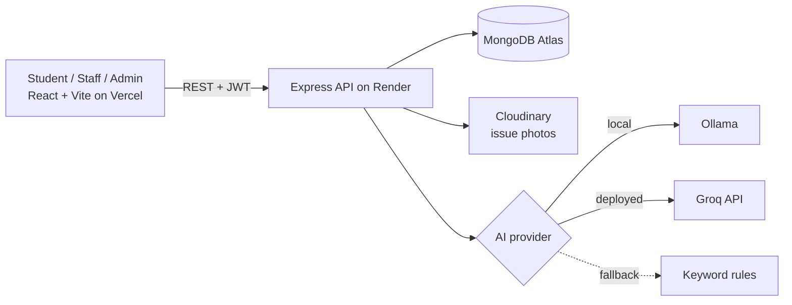

# CampusConnect AI

A full-stack campus issue tracker. Students report problems (broken fan, dead WiFi, missing library book), AI sorts each report by type and priority, staff fix them, and admins watch the whole campus. Each role has its own dashboard.

**Live demo:** https://campusconnect-ai-pi.vercel.app/login
**Demo logins:** | Role | Email | Password |
|---|---|---|
| Student | anjaligupta05092006@gmail.com | anjaligupta@01 |
| Staff | rishistaff@gamil.com | rishistaff|
| Admin | admin@campus.com | Admin@12345 |

## Screenshots

| Student dashboard | Report an issue |
|---|---|
|  |  |

| Staff work queue | Admin overview |
|---|---|
|  |  |

## Features

**Students**
- Report an issue with a photo; AI picks the category, priority and a one-line summary
- Follow every issue on a 4-step progress bar (Reported, Assigned, In progress, Resolved)
- Full history timeline, comments with staff, notifications, search and filters
- Campus assistant chatbot that explains how the app works

**Staff**
- Work queue sorted by urgency, with filters, search and pagination
- Assign issues, change status, and write a resolution note the student can read
- Live campus activity feed and status chart

**Admins**
- Analytics: issues by status, type and priority, plus average time to resolve
- "Needs attention" list of open urgent and high priority issues
- User and role management (promote students to staff or admin)

## How the AI works

When an issue is submitted, the backend asks an LLM for a JSON answer (`summary`, `category`, `priority`). The answer is validated against fixed lists, so a bad model reply can never save invalid data. If the model is down, times out or returns garbage, keyword rules take over and the app keeps working. Rules also stop the model from lowering the priority of safety emergencies (fire, sparking, flooding).

- **Local development:** [Ollama](https://ollama.com) (`qwen2.5:1.5b` by default)
- **Deployed:** [Groq](https://groq.com) API (free tier)
- Switched with one variable: `AI_PROVIDER=ollama | groq | none`

## Architecture



## Tech stack

| Area | Tools |
|---|---|
| Frontend | React, Vite, React Router, Recharts |
| Backend | Node.js, Express 5, Mongoose |
| Database | MongoDB (Atlas) |
| Auth | JWT, bcrypt, role-based access (student, staff, admin) |
| AI | Ollama (local), Groq (cloud), rule-based fallback |
| Security | Helmet, rate limiting, CORS allow-list, input validation |
| Files | Multer + Cloudinary |
| Tests | Node's built-in test runner |
| Hosting | Vercel, Render, MongoDB Atlas |

## Run it locally

You need Node 20+, a MongoDB database (local or Atlas), and optionally Ollama.

```bash
# 1. Backend
cd backend
cp .env.example .env        # then fill in MONGO_URI and JWT_SECRET
npm install
npm run dev                 # http://localhost:5000

# 2. Frontend (new terminal)
cd frontend
cp .env.example .env
npm install
npm run dev                 # http://localhost:5173

# 3. Optional: local AI
ollama pull qwen2.5:1.5b
```

Create the first admin account:

```bash
cd backend
ADMIN_EMAIL=you@example.com ADMIN_PASSWORD='StrongPass123' npm run create-admin
```

Anyone who registers through the site becomes a student. Admins promote staff from the admin dashboard.

Run the tests: `cd backend && npm test`

## Environment variables (backend)

| Name | Purpose |
|---|---|
| `MONGO_URI` | MongoDB connection string |
| `JWT_SECRET` | Long random string used to sign login tokens |
| `CORS_ORIGIN` | Allowed frontend URL(s), comma separated |
| `AI_PROVIDER` | `ollama`, `groq` or `none` |
| `GROQ_API_KEY` | Needed when `AI_PROVIDER=groq` |
| `CLOUDINARY_CLOUD_NAME`, `CLOUDINARY_API_KEY`, `CLOUDINARY_API_SECRET` | Photo storage in production (empty locally) |

Frontend: `VITE_API_URL` is the backend address.

## API overview

| Method and path | Who | What it does |
|---|---|---|
| `POST /api/auth/register`, `/login` | Anyone | Create a student account, log in |
| `POST /api/issues` | Student | Report an issue (multipart, optional photo) |
| `GET /api/issues/my` | Student | My issues |
| `GET /api/issues/all` | Staff, admin | Every issue |
| `PATCH /api/issues/:id/status` | Staff, admin | Change status (resolution note required to resolve) |
| `PATCH /api/issues/:id/assign` | Staff, admin | Assign to a staff member |
| `GET/POST /api/issues/:id/comments` | Participants | Read and add comments |
| `GET /api/issues/:id/activity` | Participants | History of one issue |
| `GET /api/notifications`, `PATCH /api/notifications/:id/read` | Signed in | Notifications |
| `GET /api/admin/analytics`, `/users` | Admin | Analytics, user list |
| `PATCH /api/admin/users/:id/role` | Admin | Change a role |
| `POST /api/ai/assistant` | Signed in | Campus assistant |
| `GET /health` | Anyone | Health check |

## What I would add next

- Email notifications
- Staff categories so issues route to the right team automatically
- More tests for the API routes 